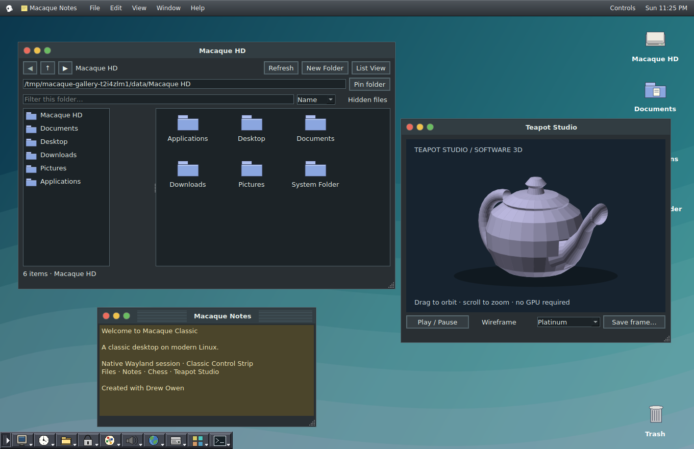
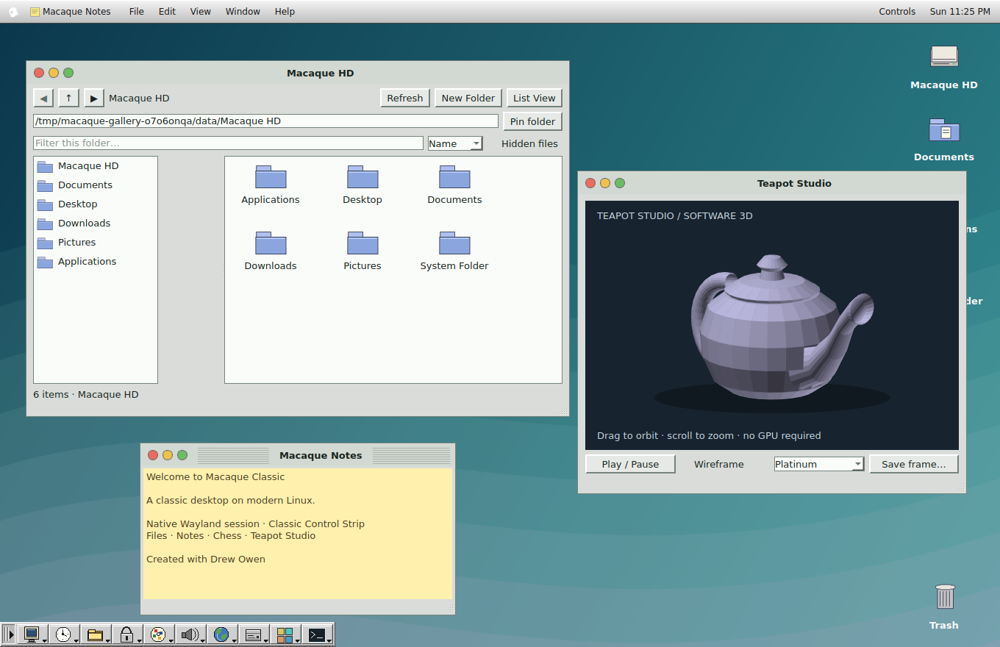

# Macaque Classic 0.36 — Setup & Everyday Essentials

Build: extract this kit into a new folder, open that folder in a terminal and run `bash build-iso.sh`. The ISO and checksum are always placed directly in `output/` after assembly/readback. The BIOS QEMU test then runs and saves its result alongside the ISO. A failed or inconclusive boot test no longer hides the assembled image in a root-owned build directory. Failure still means manual boot testing is required before installing.

## Included in this update

- Non-skippable 15-second welcome: no Skip/Mute buttons; Escape, Return, accept/reject and close requests do not dismiss it before completion. First-login-only policy retained; normal OS shutdown remains under system control.
- Setup Assistant follows the intro: appearance/sound, native Wi-Fi link, validated system time-zone selection through timedatectl/polkit, and essential app links. Finish records completion; reopen from the monkey menu.
- Lock & Sleep: lock, inspect session/lid policy, idle controls and lock-before-suspend. New ISO logind policy suspends on lid close and ignores it when docked. Desktop-package updates retain existing system lid policy. Real wake, docking and password authentication require hardware testing.
- Software Center: confirm adding official user Flathub, refresh metadata, browse/search, list installed user apps and available updates, confirm install/remove/update and launch through native integration. Asynchronous operations have timeouts and close protection. Network and Wayland-capable apps required; real downloads untested here.
- Backup & Recovery: native personal-subfolder backup (hidden files/symlinks excluded), recovery into a fresh folder, and validated appearance/accessibility/clock preference recovery with confirmation and a backup of current settings. Existing 250 MB / 10,000-file limits apply. Startup app lists/executable paths are not imported.
- Accessibility: 11–24 px text, high contrast, visible keyboard focus, reduced motion and keyboard guide. Larger text expands the panel height to fit. Reduced motion shows a still welcome card for the full intro duration. Settings Controls now scrolls.

### Retained welcome soundtrack

- Original gentle synth-and-bell welcome music now accompanies the 15-second intro. Warm chords and a short melody are synthesized locally; no sampled commercial recording is included.
- Welcome music is a separate event in Classic Sounds. Global sound enable, event mute, Do Not Disturb, effects volume and the system output volume apply. The intro has no Mute/Skip controls and ignores dismissal shortcuts until it finishes; existing system sound preferences still apply.
- Updated welcome-preview.mp4 includes the new track. Automatic first-login-only guards, manual replay, and the first-run flow are retained.

### Retained first-run welcome features

- Original 15-second full-screen Qt welcome animation: Hello/Bonjour/Hola, rainbow macaque logo reveal, Welcome to Macaque Classic, Made by Drew and original welcome music. It renders directly in Qt; the included MP4 is a watchable preview of the same frames, not a runtime dependency.
- Automatic playback happens once per account for a newly installed target, on the first native login. Calamares creates a stable installation ID. Existing targets without that new ID are not opted in by a desktop update. Live USB and desktop-preview sessions never auto-play it.
- A private persistent claim is written before playback, so an interrupted session or a crash does not trigger another automatic greeting. If that claim cannot be saved, automatic playback is skipped rather than risking a loop.
- The intro completes before Setup Assistant opens. Existing sound preferences, event settings, Do Not Disturb and system output volume are respected.
- Monkey system menu → Replay Welcome lets you watch it manually, including in previews. Replaying does not reset the automatic first-run claim.
- Includes welcome-preview.mp4 with the original music. This preview is encoded from the actual Qt animation; real installed-session playback, compositor stacking, audio hardware and end-to-end first-login installation still need VM/hardware testing.

### Retained desktop features

- Compact top panel: 22 logical pixels (previous released default: 32), spacious mode: 28. Text remains 12 px; icon sizes are retained.
- Always-visible search button beside Controls opens the internal apps/files search. Native Macaque sessions also offer an explicit This PC home-files scope. Hidden files and symlinks are excluded; scans stop at 10,000 entries or 250 matching files. Preview sessions keep search inside the managed Classic volume.
- New front-facing macaque crest with six horizontal retro rainbow colors, inspired by the small host-panel logo reference. This is a redraw, not the exact original asset.
- Full source kit: no separate panel patch required. This version identifies itself as 0.36 and produces distinctly named 0.36 media.

### Retained laptop and reliability features

- Touchpad: tap to click, natural scrolling, disable while typing and pointer speed.
- Displays: modes, scale, monitor position and rotation, saved confirmed settings and an independent 20-second rollback guard. Recovery is best effort if the compositor or hardware fails.
- Power Profiles: select profiles supported by the system service.
- Bluetooth: power, discovery, connect/disconnect, confirmed removal and a native PIN/passkey pairing wizard.
- Audio Devices: output/input selection, microphone level and mute, test tone.
- Recovery & Diagnostics: bounded local logs, service information and private ZIP export to Documents. Review before sharing; no automatic upload.
- Installer Status: preserved stdout/stderr, exit codes, logs and a confirmed restart action. A normal wizard exit may also mean cancellation. The final installer page offers an unchecked restart choice.

All 30 desktop suites and build-kit checks passed with offscreen Qt and simulated hardware services. ISO assembly, real hardware controls, physical installation and reboot remain unverified.

### Retained from 0.31

- Installer password rule fixed in the build: 8–128 characters, matching confirmation, no inherited dictionary-score rejection. The installed system's PAM policy is unchanged.
- Screenshot app in Applications, the system menu and Controls: Classic desktop or Classic window, plus actual Wayland full-screen and region capture through grim/slurp. Optional 0–10 second delay, pointer inclusion for native captures, preview, clipboard copy and automatic PNGs in Macaque HD/Pictures. Esc cancels region selection. Print opens the tool; Shift+Print selects a region; Ctrl+Print captures the display. Full-screen/region mode includes external app windows; Classic captures only cover the Qt desktop/windows.
- Laptop Controls panel: output volume, mute, microphone mute, screen brightness, battery status and a link to Battery & Power.
- Global Wayland laptop media keys: speaker mute/down/up, microphone mute and brightness down/up. Changes use the default PipeWire device and logind backlight controls in 5% steps. Output is capped at 100%; backlight stays at least 5%. Feedback appears over the Classic desktop and may be covered by external app windows.
- F-key row behavior follows the keyboard's media events. Fn/Fn Lock may be needed. Ordinary F1–F12 remain app shortcuts. No firmware-level Fn remapping is claimed. VM brightness and external-monitor brightness generally do not expose a supported laptop backlight.

Keyboard routing, PipeWire/logind boundaries, screenshot saving/cancel/failure cleanup and UI checks are verified with fixtures/offscreen Qt. Real laptop keys/backlight, microphone/audio hardware and live Wayland grim/slurp capture still need device testing. No new ISO was assembled here. The prior desktop was reached in VirtualBox with 3D acceleration enabled; physical USB boot remains unresolved.

## Build on Ubuntu / Kubuntu

Use an x86-64 Linux computer with Internet, Docker, about 60 GB free space and preferably 8 GB RAM. Open the extracted `macaque-classic-installer-kit-v0.36` folder in Terminal, or clone the repository. First-time Docker setup:

```bash
sudo apt update
sudo apt install docker.io
sudo systemctl start docker
```

Then run:

```bash
bash build-iso.sh
```

The builder uses a privileged Debian live-build container. It mounts this kit and its output folder; it does not flash USB or install to the host. Finished media is `output/macaque-classic-0.36-installer-DATE-TIME.iso` with `.sha256` and `.boot-check.json`. Boot-test logs are `output/boot-check.log` and `output/boot-check.qemu.log`. The generated ISO is copied before the QEMU test. An inconclusive test is reported explicitly; it is not a successful boot certification. The earlier empty serial-log failure can occur while the manually booted VM reaches the desktop. Manual VirtualBox testing requires VMSVGA with 3D acceleration enabled for the accelerated compositor.

## Installed desktop update

The included `packages/macaque-classic_0.36_amd64.deb` is only for an existing installed Macaque target, not the live USB or your normal Ubuntu/Kubuntu build host. It rebuilds the Control Strip for target Qt and may download dependencies:

```bash
sudo apt install ./packages/macaque-classic_0.36_amd64.deb
```

Save work and reboot afterward. Installer-policy and boot-image changes require a new ISO; a desktop update cannot change an already-built ISO. Package configuration is not tested in a real target chroot here. Keep your older working image and backups.

## Wayland and compatibility

The OS uses labwc, greetd/gtkgreet, native Qt/GTK/SDL Wayland clients, swaylock, swayidle and GTK/wlroots portals. Debian's labwc package pulls in XWayland binaries, but the session disables the XWayland server and provides no automatic X11 fallback. Flatpaks are launched with Wayland access and X11 sockets disabled. Older X11-only applications and some emulator builds will not run. External apps retain compositor-managed windows above the Classic desktop; internal apps use classic Qt frames.

The installed login requires a password. Live media has the `macaque` account and live-only recovery console on Ctrl+Alt+F2. Recovery autologin/account-initialization overrides are removed from the installed target. Lid closing uses system logind policy; custom lid actions are disabled. The visual screensaver is not a secure lock.

The offline installer and checked GRUB wrapper retain selected-disk handling and root UUID checks. Another physical disk can retain an older bootloader; do not rewrite other disks blindly. Swap defaults to none, with an optional swap file. Actual physical USB/bootloader installation remains unverified for this release.

## Testing and publication

26 desktop suites pass offscreen, including native Control Strip loading, real internal screenshot PNG/clipboard checks, media key routing and mocked PipeWire/logind/grim/slurp boundaries. Build-kit fixtures check password rules and installed recovery cleanup. The authoring runtime denies AF_UNIX, so the real shortcut socket test is explicitly skipped. No 0.36 ISO assembly, live display capture, PAM authentication or physical laptop key/backlight/audio test ran here.

[GitHub releases](https://github.com/Zerocool66612/Classic-Macaque-Os/releases) contain published ISO assets; source archives are build kits. Source pushes do not upload an ISO or update installed machines. Software Update discovers matching desktop `.deb` and `.deb.sha256` release assets. No signed custom Macaque update feed is claimed.

## Desktop gallery (0.30.4)

Current 0.30.4 UI, rendered from the Qt desktop code with the real embedded Control Strip and example data. These are offscreen UI captures, not photographs of a hardware boot. The author has reached the desktop in VirtualBox with 3D acceleration enabled; physical USB boot and installation remain under testing.

### Dark mode



### Light mode



The system menu uses the new white macaque profile, with green only on hover/press. ISO files belong under **Releases → Assets**; GitHub's source ZIP is a build kit, not a bootable ISO. Check the version shown on each release before downloading.

---

Project direction and original Control Strip: Drew Owen. AI-assisted development. No general project redistribution license has been selected; dependency notices remain in effect. No Apple ROM, OS image or application is bundled. Classic Mac emulator configuration does not implement Mac OS 9.2.2 application compatibility. No UNIX certification is claimed.
