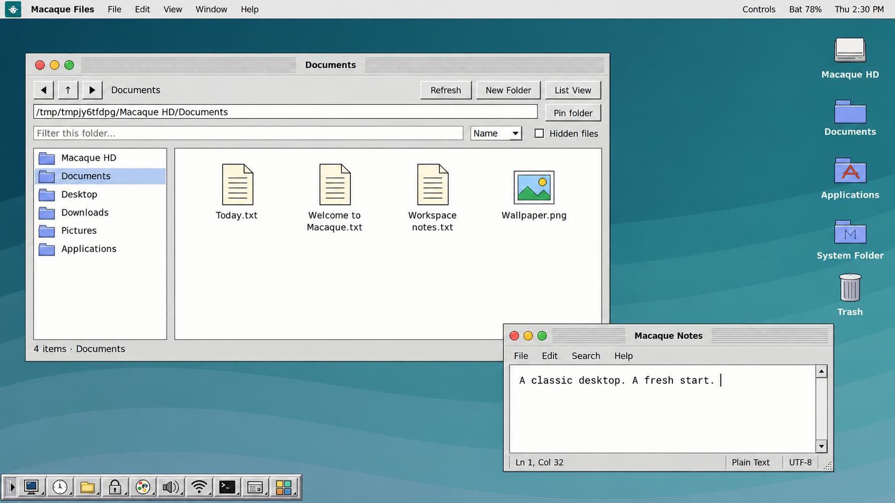
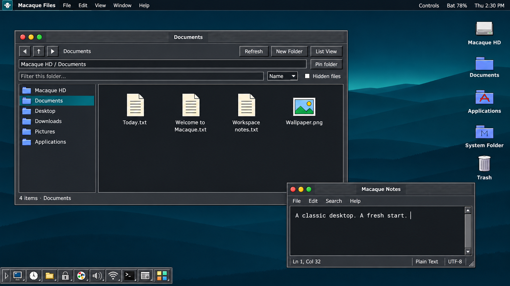

# Macaque Classic 0.28 installer build kit

This repository contains the desktop source and ISO builder, **not a finished ISO**. Existing installations do not update automatically.

## Get the source

```bash
git clone https://github.com/Zerocool66612/Classic-Macaque-Os.git
cd Classic-Macaque-Os
bash build-iso.sh
```

Install Docker first as described below.

## Build on Ubuntu / Kubuntu

You need x86-64 Linux, an Internet connection for the build, about 60 GB free space and preferably 8 GB RAM. If Docker is already installed and running, open a terminal inside `macaque-classic-installer-kit-v0.28` and run:

```bash
bash build-iso.sh
```

First-time builder setup:

```bash
sudo apt update
sudo apt install docker.io
sudo systemctl start docker
bash build-iso.sh
```

The privileged Docker container is used for live-build mount/chroot operations. Only this kit and its output directory are mounted into it. The script does not write USB sticks, partition disks or install onto the host.

On success, `output/` contains `macaque-classic-0.28-installer-DATE-TIME.iso`, its SHA-256 file, package manifest and build log. The finished ISO is directly in output, not in the source folder named iso. Build workspaces are retained separately for diagnosis; do not delete them or change source during a build.

## Changes in 0.28

**Login-style menu bar.** The desktop's light top bar now uses the login screen's platinum gradient (#f5f5f5 to #bdbdbd), dark lettering, bright upper edge and fine lower border. Dark mode uses the same raised treatment in graphite. Compact menu spacing, battery status, Controls and the white monkey mark remain; the mark has a teal backing for contrast. The change affects desktop styling only.

## Changes inherited from 0.27

**Bootloader installation checks.** Calamares now invokes a checked GRUB installer that removes a stale device.map, forces fresh device probing with --recheck, refuses forced blocklist installation, regenerates grub.cfg, verifies the installed root UUID, kernel/initramfs and normal.mod, and records /var/log/macaque-bootloader.json. The selected disk/ESP still comes from Calamares; no helper silently writes other disks.

**Two internal disks:** choose the intended bootloader drive in the installer and make that same drive first in the laptop firmware's boot order. An older GRUB on the other disk can still produce a missing UUID rescue prompt. Rebuilding alone cannot change firmware boot order or repair an already-installed disk. The observed failure was bypassed by pointing GRUB to the readable second disk; the exact on-disk cause remains unconfirmed.

This kit is not a finished ISO. Boot files/configuration checks are not a substitute for reboot testing. Actual BIOS/UEFI installs remain unverified in the authoring environment.

## Changes inherited from 0.26

**Laptop Wi-Fi and battery.** Controls > Wi-Fi & Network now scans actual nearby networks, shows signal/security/current connection, turns Wi-Fi on/off and connects to visible or hidden networks. Connect opens nmcli's interactive password prompt inside the normal Macaque Terminal frame. Type your Wi-Fi password and press Enter; input may be hidden. No password is placed in a command line, shell history or Macaque preferences. NetworkManager saves successful profiles and reconnects. Existing wired connections remain managed by NetworkManager. Wi-Fi actions affect the running Linux system, including when the desktop is launched as a prototype.

The quiet top bar now shows laptop battery percentage and charging state, updated every ten seconds. Click for per-battery details. No battery indicator is shown on desktops with no system battery. Unknown readings are shown honestly; peripheral batteries are excluded. No remaining-time estimate is invented.

Added Atheros, Broadcom brcm80211 and MediaTek firmware alongside existing Intel/Realtek firmware, wpasupplicant and rfkill. Proprietary Broadcom wl-only adapters are not covered. Physical airplane-mode switches, unsupported drivers and enterprise authentication may require additional setup. Real laptop Wi-Fi and charging tests remain necessary.

## Changes inherited from 0.25

**Classic startup and login.** Original platinum gray startup panel, Macaque emblem, blue progress bar tied to Plymouth boot progress, and matching LightDM login theme. Live USB still logs in automatically; installed systems display the login screen unless you choose automatic login in the installer. Login authentication stays with LightDM/PAM. Keyboard layout, accessibility, session and shutdown controls remain available. Password and question prompts are supported by the boot theme; Esc switches to boot messages. Very early firmware/GRUB screens and unsupported graphics modes may still show text. This is a startup theme, not a new screen-lock feature.

Build hook selects the Plymouth theme and regenerates installed kernel initramfs images; live and installed boot commands include quiet splash. Actual boot, sign-in and disk installation still require VM/hardware verification.

## Changes inherited from 0.24

**Built-in Terminal.** The Control Strip >_ button and desktop icon now open a real Linux shell inside the standard Macaque window, with traffic lights, animations and internal workspaces. Ctrl+C interrupts commands; Ctrl+Shift+C / V copies and pastes; Shift+PageUp / PageDown scrolls. This is a lightweight, monochrome VT-style terminal with ANSI cursor handling and scrollback, not a complete xterm replacement. Commands execute as your current Linux user and affect the running computer. xterm remains on the image as a fallback diagnostic tool.

**Offline bootloader setup.** The builder downloads version-matched grub-pc and grub-efi-amd64 wrapper packages into the image and records checksums. Both GRUB platform binaries, shared tools, package dependencies and encryption-initramfs tools are preinstalled. Calamares installs the appropriate cached package inside the target chroot, verifies its checksum and uses its normal bootloader module to write the chosen disk/ESP. Debian's online bootloader-config and temporary online media-source jobs are removed from the workflow. Live-package removal remains enabled, with repository updates disabled. Standard installation no longer needs to resolve deb.debian.org for GRUB; building the ISO still needs Internet access. BIOS/UEFI installation and reboot remain to be tested in a VM. Secure Boot, encryption, manual partitioning and dual boot are not validated Macaque features.

**Macaque installer branding.** Original Macaque monkey logo, welcome artwork, teal sidebar and three installation slides replace the Debian installer artwork. Required branding keys and referenced files are checked. Debian/Calamares licenses and underlying distro identity are preserved. The internal EFI bootloader ID remains `debian` for compatibility with Debian's signed GRUB paths; the desktop and installer product name are Macaque Classic.

The Control Strip Terminal button, guided swap release, default **No swap**, optional swap file, QtTest dependency and submenu-lifetime fixes from previous builds are included.

## First test

1. Build the ISO, then write it with an image writer. Verify the write if available. Test a VM first with a new 40 GB virtual disk, 4–8 GB RAM and 2–4 CPUs; start with VMSVGA and 3D acceleration off.
2. Boot the new image. Open Terminal from the Control Strip or desktop and verify it has Macaque decorations.
3. Click **Install Macaque Classic**. In Install Preparation, identify the intended disk by model and capacity. Device letters can change between boots.
4. If that disk has active swap, use **Release Selected Disk’s Swap**, confirm the named disk, and refresh to verify. The helper excludes the live boot disk and other disks, and does not format or remove partitions. It skips swap files/encrypted mappings and reports insufficient-memory errors.
5. Continue to Calamares and select the same physical target again. Keep **No swap** for the initial test. Review the final summary before applying changes: installation can erase the selected disk.
6. After successful installation, reboot and remove the USB when prompted. Verify login, Terminal, networking and a second reboot before trying another machine.

Do not unplug live media while it is running. `SQUASHFS` / `loop0` input/output errors need investigation of the ISO/write/media/connection; this build does not establish that the earlier USB problem has been fixed.

## Validation and limitations

The authoring environment cannot assemble a bootable ISO because it lacks mount/chroot capabilities. Desktop tests, a real PTY shell, target-preparation fixtures, cached-package checksum checks and branding-file checks are performed separately. Mocked dpkg calls do not prove bootloader installation. The builder itself runs the desktop tests inside Debian before making the ISO, checks BIOS/EFI boot entries, and extracts the generated SquashFS to verify it can be read back.

The live account is `macaque` with Debian Live's normal live-session administration policy. The installed account/password are chosen in Calamares. Live autologin defaults and live sudo policy are removed from the target. No Apple ROMs, classic OS images or emulator binaries are bundled. Flatpak is included; app installation requires its own Internet connection.

For logs in the live session, use Terminal:

```bash
sudo calamares -d 2>&1 | tee ~/installer-debug.log
```

If installation is already running, finish or close that instance first. Files in the live home folder are temporary; save diagnostics externally before restarting.

Builds use current Debian repositories and a moving container tag, so they are not byte-for-byte reproducible. Preserve upstream notices and dependency licenses. No new general source license is selected by this kit.

## Desktop concepts

AI-generated visual concepts, not screenshots of the running release.





## Actual menu-bar previews

Captured from the running Qt desktop in light and dark mode.


