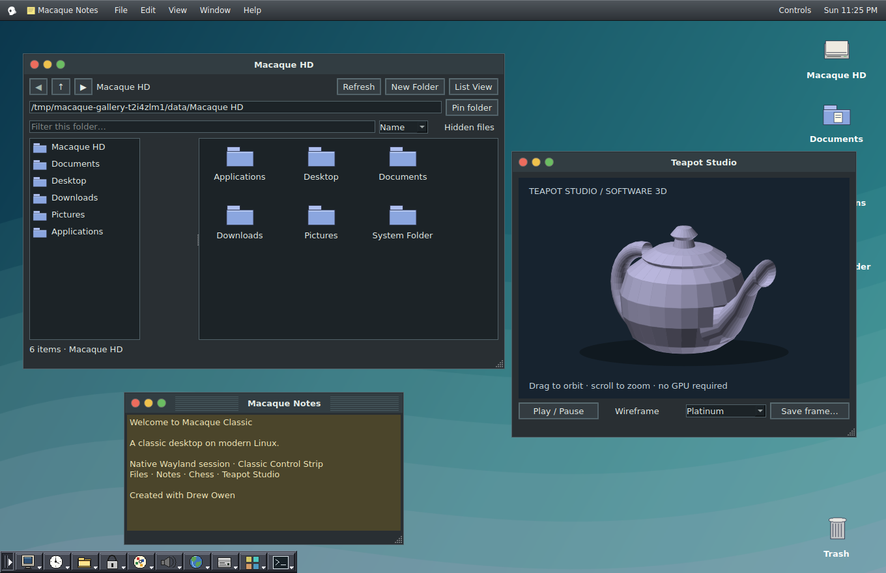
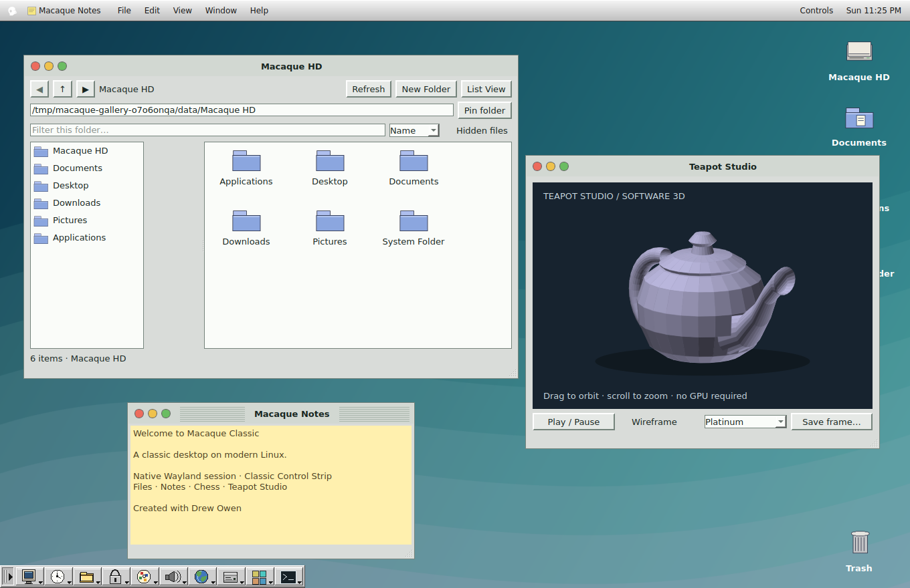

# Macaque Classic 0.30.4

A classic-inspired desktop on modern Linux, with a native Wayland session, Classic Control Strip, traffic-light window controls, internal apps and light/dark themes. Project direction and original Control Strip: **Drew Owen**.

[ISO downloads and release notes](https://github.com/Zerocool66612/Classic-Macaque-Os/releases) · [Source build instructions](#build-the-iso-on-ubuntu--kubuntu)

## Desktop gallery

Current 0.30.4 UI, rendered from the Qt desktop code with the real embedded Control Strip and example data. These are offscreen UI captures, not photographs of a hardware boot. The author has reached the desktop in VirtualBox with 3D acceleration enabled; physical USB boot and installation remain under testing.

### Dark mode



### Light mode



The system menu uses the new white macaque profile, with green only on hover/press. ISO files belong under **Releases → Assets**; GitHub's source ZIP is a build kit, not a bootable ISO. Check the version shown on each release before downloading.

---

# 0.30.4 system-menu polish

The system-menu button now has a transparent idle background. Its accent appears only on hover or press. The white icon is an original right-facing macaque silhouette with a rounded crown, projecting muzzle and ear cutout. Boot/session behavior is unchanged from 0.30.3.

# 0.30.3 diagnostic boot rebuild

Restores APT recommends to the previous pre-Wayland build setting, retains native Wayland, selects a broad initramfs module set, and boots live media with visible kernel/systemd output instead of quiet splash. This is a diagnostic change; the exact physical boot failure remains unconfirmed.

The builder now boots the actual generated ISO in a diskless BIOS QEMU VM using software emulation. It requires a live-user-ready marker before copying the final named ISO/checksum into output. The check may take up to five minutes. If it fails, send `output/boot-check.log` and `output/boot-check.qemu.log`; do not flash a candidate from a retained build folder. This check covers reaching live userspace, not graphics, UEFI, physical USB boot or the installer. No automatic VM boot was executed in the authoring environment because no ISO was assembled here.

Extract this kit into a fresh folder and run `bash build-iso.sh`. Keep your older working ISO. The live boot temporarily shows diagnostic text rather than the classic splash. The installed-system theme remains configured separately.

> 0.30.3 startup repair preview: explicit Debian common PAM policy, live-only user/password initialization before greetd, and a live-only automatic recovery console on Ctrl+Alt+F2. Greetd failure stops instead of repeatedly taking the console. These are candidate repairs for the reported authentication failure; its exact cause is unconfirmed and a physical USB boot remains untested. Installed targets remove all recovery autologin/account-setup overrides.

# Macaque Classic 0.30.3 — Wayland preview

A classic-inspired Qt desktop with an embedded Control Strip, internal apps and a Debian 13 live/install image builder. The new OS session uses **native Wayland** through labwc, with greetd/gtkgreet login. This download is a **source/build kit, not a finished ISO**. Existing installations do not change until you build/install the new image or explicitly install an update.

## Build the ISO on Ubuntu / Kubuntu

Use an x86-64 Linux computer, an Internet connection, about 60 GB free space and preferably at least 8 GB RAM. Extract the `.tar.gz` into a new folder; do not merge it into an older kit. Alternatively clone the source:

```bash
git clone https://github.com/Zerocool66612/Classic-Macaque-Os.git
cd Classic-Macaque-Os
```

For the downloaded kit, open its extracted `macaque-classic-installer-kit-v0.30.4` folder in a terminal. If Docker is not installed:

```bash
sudo apt update
sudo apt install docker.io
sudo systemctl start docker
```

Then build:

```bash
bash build-iso.sh
```

The privileged Docker container runs Debian live-build mount/chroot operations. It mounts only this kit and its output folder, not host disks or your home directory. It does not flash USB sticks or install Macaque on the build computer.

A successful build writes `output/macaque-classic-0.30.3-installer-DATE-TIME.iso`, its SHA-256 checksum, logs, a package manifest and a desktop `.deb`. The `iso/` folder contains builder source. It is not the boot image. Write the finished `.iso` with your USB imaging tool, then boot that USB. Test on an empty virtual disk before installing to a laptop. Calamares lets you review disk changes before applying them.

Keep source unchanged while building. Retained `output/build-*` folders are diagnostic workspaces. The builder reads back the entire generated SquashFS and checks BIOS/EFI entries; this does not replace a boot test.

## 0.30.3 packaging repair

The desktop now includes its own labwc configuration. Both the installed session and nested preview use that same file. Build-kit checks run test_creative.py from the staged /opt/macaque-classic layout, where the 0.30 build failed. This fixes the reported hook failure; full ISO assembly/boot still requires the builder machine.

## What changed for Wayland

- **Desktop session:** labwc owns the display; Qt, GTK and SDL clients use Wayland. The Classic desktop remains maximized beneath external apps. Alt+Tab switches between the desktop and external windows. Internal apps keep their classic window frames, animations, top bar and Control Strip.
- **Login:** greetd runs a separate labwc/gtkgreet login compositor with the platinum artwork. Live media logs in as `macaque` once; installed systems require a username/password. The old LightDM session is no longer generated. The installer automatic-login option is not supported by this preview.
- **Locking:** Ctrl+Alt+L and Battery & Power request swaylock, which authenticates with PAM. The visual Screen Saver Preview remains separate. The idle service requests locking before suspend and before blanking outputs.
- **Power:** swayidle handles idle dimming/blanking; brightness uses logind. Lid closing uses logind's system suspend policy. Custom lid-action dropdowns are disabled in this preview. Battery readings and low-battery alerts remain available.
- **Apps:** native launches and Flatpaks receive Wayland settings. Flatpak launches explicitly deny X11/fallback-X11 sockets. Wayland-capable builds are required; some Audacity, emulator or other older builds may not work. There is no automatic X11 fallback.
- **Portals:** PipeWire plus the wlroots screen-cast/screenshot portal and GTK file-dialog portal are included. OBS must use its PipeWire/Wayland capture source; X11 capture sources do not apply.
- **Terminal:** the built-in PTY terminal retains the Classic frame. Ctrl+Alt+T requests it through a user-only control socket; foot provides a recovery fallback if the desktop is unavailable.

Debian's labwc package depends on the `xwayland` package, so compatibility binaries/libraries can still be present. The session disables the XWayland server executable and removes X display credentials from clients. Presence of that dependency does not mean the session runs under X11. The old X11 client-environment branches remain for old prototype callers; the new OS and preview launchers select Wayland explicitly.

## Updating an existing installed Macaque system

**A fresh ISO test is recommended for this display-stack change.** Keep your working image and backups. The included desktop package is for an existing installed Macaque system, never your ordinary Ubuntu/Kubuntu build host or a live USB.

On the installed Macaque target only:

```bash
sudo apt install ./packages/macaque-classic_0.30.4_amd64.deb
```

APT may download dependencies. The package builds the native Control Strip against the target Qt, backs up the prior greetd configuration once, configures the new Wayland login and selects greetd for the next boot. Save your work and reboot. It does not change GRUB, partitions, kernels or user files. Display-manager migration and privileged package installation have not been tested on hardware here; there is no automatic rollback. For recovery, a text console can restore the previous LightDM service/configuration if that older installation still has it.

Build a replacement package with `python3 build-desktop-deb.py`. Software Update discovers matching `.deb` plus `.deb.sha256` assets in GitHub Releases. Source pushes alone do not update installed machines. Downloads use GitHub HTTPS plus a checksum, not a signed Macaque package repository. No update installs automatically.

## Desktop features retained

Wi-Fi personal-network passwords and profiles through NetworkManager; per-battery status; USB/SD discovery, mount/unmount/eject and explicit non-overwriting file import/export; signed Debian APT updates through the internal Terminal; internal file manager, text editor, notes, search, settings, backup/recovery, games, wallpapers, original sounds, animations and light/dark modes. Search defaults to the Classic data volume. External app windows remain compositor-managed rather than embedded Qt subwindows.

No Apple ROM, operating-system image or application is included. Classic Mac emulator configuration is experimental and does not provide Mac OS 9.2.2 compatibility by itself. Wayland-capable emulator builds are needed in this session.

## Preview without replacing your host desktop

From the extracted `desktop/` folder, `bash run.sh` starts the internal-app prototype in an ordinary host window. For a nested **Wayland** preview, use a host already logged into Wayland:

```bash
bash install-app-support.sh
bash run-app-session.sh
```

The nested preview does not change the host login manager. Physical power changes and screen locking are disabled there. Native apps are contained by the nested compositor. A host X11 session is not supported by this preview launcher. Creative-app setup remains optional: `bash install-creative-apps.sh`.

## Installer and boot notes

Original Plymouth startup artwork and prompts are retained. Firmware/early GRUB messages may still appear. Calamares uses Macaque branding and launches as a native Wayland client from live media. The offline BIOS/EFI bootloader package cache, fresh GRUB device probing, root UUID checks and installer report remain in place. Choose the correct bootloader disk; another disk may still contain an older GRUB. The installer does not automatically rewrite other disks to repair their bootloaders.

The default installation uses no swap, with an optional swap file. Install Preparation can identify and explicitly release active swap on the chosen target. Busy/system disks are not force-unmounted. Nothing here establishes UNIX certification.

## Validation and limits

The 22 desktop suites pass using Qt offscreen. The build-kit tests check staged files, configuration, offline installer jobs, cached-package guards and bootloader arguments with fixtures/mocks. Wayland environment selection, Flatpak arguments, power-policy commands and shortcut request validation are covered. The local runtime denies Unix sockets, so the live shortcut transport test is explicitly skipped and a real compositor session cannot run here.

No v0.30.4 ISO was assembled or booted in this environment. GPU/DRM startup, greetd/PAM login, actual locking/unlocking, screen capture, lid/suspend/resume, Wi-Fi authentication, removable-media authorization and the privileged desktop migration require target-machine testing. Fractional scaling, multiple monitors and external application compatibility are not validated. See `desktop/STATUS.md`.

Project direction and original Control Strip: Drew Owen. AI-assisted development. No general project redistribution license has been selected; upstream dependency notices remain in effect. Design previews and older desktop images in the repository are illustrations/historical captures, not proof of this Wayland build running.
