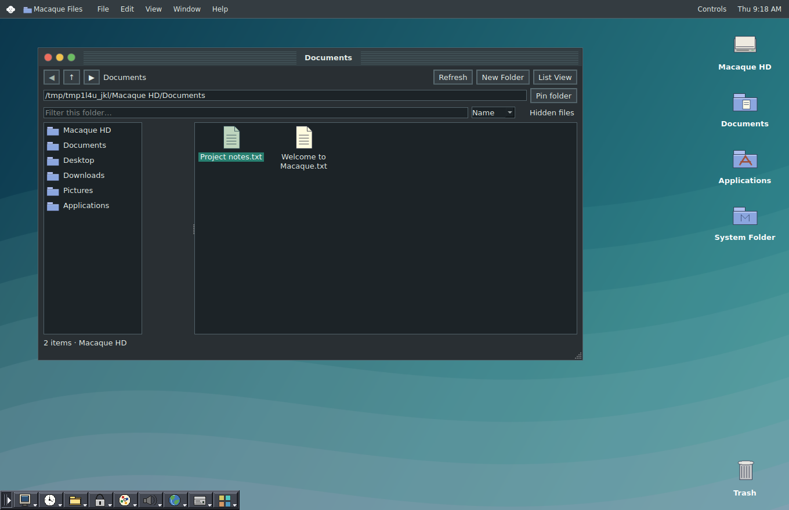

> Current release: **0.30 Wayland preview**. Read the root README for current ISO, session and compatibility instructions. The older release notes below describe the previous prototype; references to Xephyr/Openbox and X11 do not describe the new OS session.

## Laptop & Updates (0.29)

Controls now opens Wi-Fi & Network, Battery & Power, USB Drives and Software Update. Use the root build-kit README for update/install instructions and current hardware-test limitations. Ctrl+Alt+L requests the real session locker in a native Macaque login session. The Screen Saver Preview remains a visual effect.

# v0.22.1 Desktop right-click fix

Right-click empty wallpaper to open the desktop menu: New Folder, New Text Document, Paste, New Sticky, Clean Up Desktop, Refresh, Wallpapers, Appearance, Mouse and Settings. Background mouse events now route directly through the desktop event filter.

# v0.22 Right-click menus

Right-click files and folders for Open, Cut, Copy, Paste, Rename, Duplicate, Move to Trash and Properties / Get Info. Multiple selected items are supported. Right-click empty file space for New Folder, New Text Document, Paste, Refresh, view, sorting, hidden files and Select All. Desktop background, fixed desktop icons, Trash and title bars also have menus. Text fields keep standard Qt editing menus. Protected system items and host folders remain read only. File clipboard is internal to Macaque.

# v0.21 UI polish

White monkey menu mark; built-in window opening and closing effects. Choose Soft Zoom, Fade, Slide or None independently in Controls → Settings → Animations. Speed, Preview and Reduce Motion are included. Native Linux and emulator windows keep their own effects.

# Macaque Classic

A classic-inspired Linux desktop prototype with an icon-only system menu,
traffic-light windows, the native Classic Control Strip, original sounds and
built-in desktop apps. Created with project direction by Drew Owen.

**Current preview: 0.29.** The desktop can run as a Linux application or in the Debian-based Macaque Classic live/install image.
See [STATUS.md](STATUS.md) for tested features and compatibility limits, and
[CHANGELOG.md](CHANGELOG.md) for release history.

## Run the Classic desktop

Extract the release, open a terminal in this folder, and run:

    bash run.sh

Python 3.10+, PySide6 and chess are required. The launcher uses a virtual environment
and installs requirements when needed. The included native Control Strip binary
is for Linux x86-64. Existing Macaque HD data is reused across versions. For source
rebuilds see native/rebuild.py; Qt6 Widgets development headers, g++ and pkg-config
are required. Original Control Strip source is preserved under native/.

## New in 0.20

- **Macaque Web:** an embedded Qt WebEngine browser with tabs, navigation, bookmarks
  and explicit Save dialogs for website downloads. GIMP and Flathub links stay
  inside the application. It uses a temporary browsing profile; saved bookmarks
  and downloads persist. Certificate failures are rejected, site permissions and
  popups are disabled. Run as your regular Linux user; the app refuses root and
  sandbox-disabling configurations. Actual WebEngine page rendering could not be
  verified in this root-only environment and must be tested on your machine.
- **Four workspaces:** switch via Controls → Workspaces or Ctrl+Alt+1…4, move an
  active window, rename workspaces, and use a window overview. These organize
  internal Macaque windows; native Flatpak/emulator windows remain outside this
  workspace system. Window contents survive switching. Workspace names/current
  workspace persist, but a complete window session is not restored after restart.
- **Enhanced Macaque Files:** folder sidebar, pinned folders (Pin folder toggles
  membership), address entry, back/forward, filtering, sorting, hidden-file toggle
  and filesystem watching. F5 refreshes; Ctrl+L focuses the location field.
  Host folders retain existing read-only managed-operation behavior.
- **Welcome Center:** quick access to web/files/downloads/workspaces/backups/settings
  and recent Classic documents. Enable startup display in its checkbox or Settings.

The quiet top bar, icon-only system menu and original classic sounds remain.

## Download and install GIMP from inside Classic

1. Open **Controls → Downloads**.
2. Click **Use GIMP installer link**, then **Download**.
3. When saved, click **Install downloaded Flatpak**.
4. After installation, open Flatpak Apps → Refresh → GIMP → Launch selected.

This downloads a reference file; the Flatpak installer then downloads the actual
application/runtime. Flatpak must be installed, and native launching requires App
Session. For first-time Ubuntu/Debian setup, run from this extracted folder:

    bash install-app-support.sh
    bash run-app-session.sh

The setup script requests sudo for system packages. Downloaded files go into
Macaque HD/Downloads; downloads never install or execute automatically. The built-in
downloader accepts direct HTTPS file links, validates TLS, limits redirects to 5,
requires 30-second transfer activity, has a 5-minute overall timeout and caps each
file at 512 MB. Cancellation/failure removes temporary files. Login-dependent downloads, automatic resume and large installers are not implemented
in the direct downloader. Use Macaque Web for ordinary web pages.
Live network behavior needs testing on the user's machine; response and file
handling are tested with simulated replies.

## Features and checks

Internal files/text/notes, Search Classic (F6), calculator, Chess, Paint, Tasks,
clock/timer, media and ZIP viewers, Character Map, software-3D Teapot Studio,
wallpapers, mouse/file dragging, notifications, screenshots and Backup & Recovery.
Controls and Settings retain features without filling the top bar with icons.

Run all checks with a Python environment containing requirements.txt:

    python3 run_checks.py

The checks exercise app behavior with Qt's offscreen backend. They do not verify
speaker devices, GPU support, real Flatpak launches or Mac guest booting. See the
status table before reporting compatibility as working.

## Experimental application compatibility

[APP_COMPATIBILITY.md](APP_COMPATIBILITY.md) covers Flatpak installation/launch and
Basilisk II / SheepShaver setup. Emulators, ROMs and guest OS images are supplied
separately. Standard SheepShaver support stops at Mac OS 9.0.4; Mac OS 9.2.2 app
compatibility remains unfinished. Native apps use the optional nested App Session.

## Source and licensing

No general open-source license has been selected; see STATUS.md and preserved
upstream notices. No Apple ROMs, guest OS images or personal data are bundled.

## Publish this standalone project

The release is prepared as a standalone repository root. After creating a new,
empty GitHub repository and configuring normal Git authentication/author identity:

    bash publish-github.sh https://github.com/YOUR-NAME/macaque-classic.git

The script refuses nonempty remotes, does not force-push and does not change a
mismatched existing origin. It publishes source, original assets and the native
Control Strip binary. Ignore rules exclude virtual environments, generated data,
credentials files and ROM/disk images. Review files before publishing. No remote
repository is automatically created by this script.
